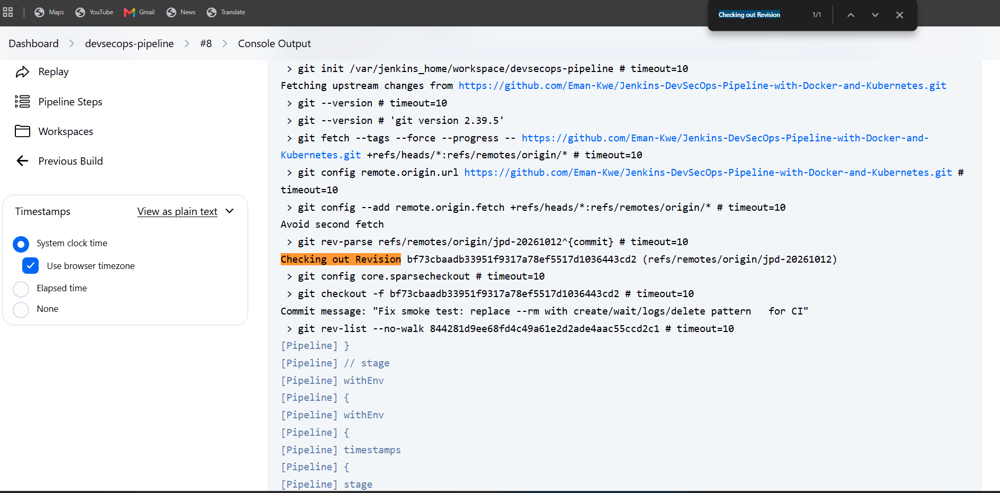
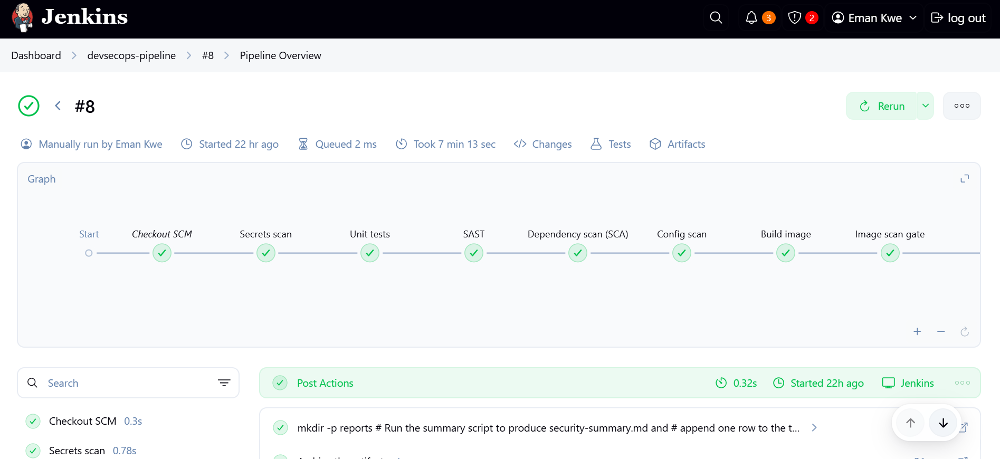
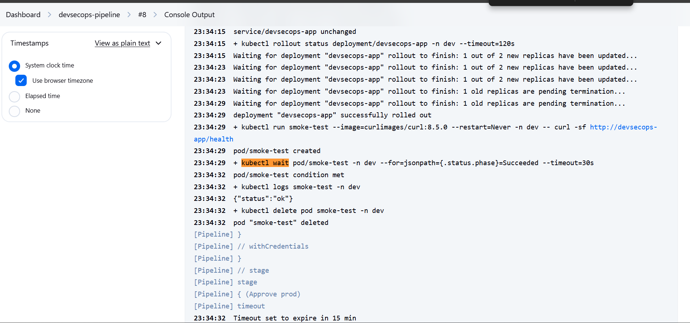
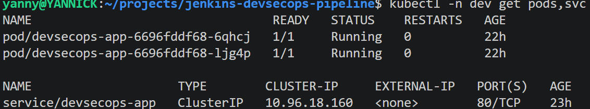
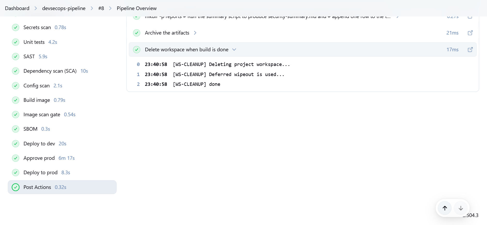
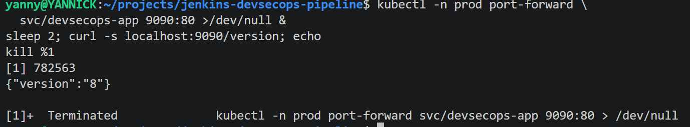
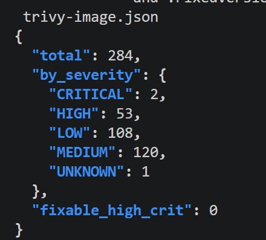
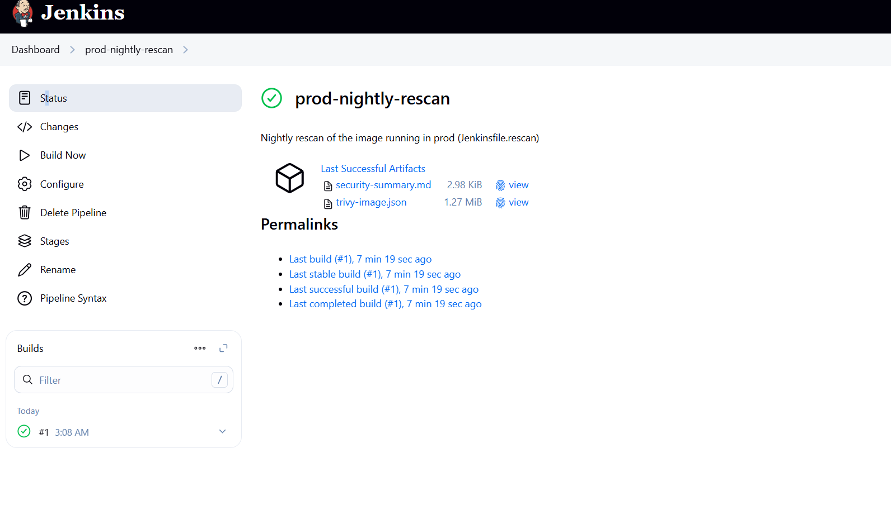

# Jenkins DevSecOps Pipeline with Docker and Kubernetes

A Jenkins pipeline that runs automated security and quality gates on a Python web app, builds a Docker image, and deploys it to Kubernetes dev and then prod, with a human approval before production. Everything runs on one local machine (WSL2, Docker, Kind).

### 🎬 Video Walkthrough

[Watch the project walkthrough](VIDEO_LINK_HERE)

> **Pending.** The video has not been recorded yet. The link above is a placeholder until I add it.

---

## Project Overview

### What this project does, in plain English

Think of it as an inspection line in a factory. Code enters Jenkins. Security and quality checks run one after another. If a gate fails, the line stops and nothing ships.

If everything passes, Docker builds the image and it is deployed to the Kubernetes **dev** namespace. A smoke test checks `/health`. A person approves production, and the same image is promoted to **prod**.

Where the analogy breaks down: a factory line only checks the product once. This pipeline also rescans the image already running in prod every night, because a clean image today can pick up a new known vulnerability tomorrow.

### Why it matters

Security is often a final manual review, after vulnerable libraries are already embedded. Fixing a vulnerable dependency before deployment is a one-line change. Fixing it after deployment is an incident. DevSecOps puts the checks inside the pipeline so problems are caught first.

### How it helps a business

| Business need | How this pipeline addresses it |
|---|---|
| **Lower risk of a breach** | Known vulnerable dependencies, leaked secrets and insecure configs are blocked before anything is deployed |
| **Lower cost of fixing problems** | Issues are caught in minutes at build time instead of in production, where fixes mean incidents and rework |
| **Faster, safer releases** | Checks run automatically on every build, so teams ship often without waiting for a manual security review |
| **Control over production** | A human approves each production release, and every deployed image traces back to one build number |
| **Audit and compliance evidence** | Every build archives its scan reports, an SBOM (a list of what is inside the image) and a trend CSV, so there is a record of what was checked and when |
| **Ongoing protection** | The nightly rescan flags new vulnerabilities in software that is already running in production |
| **Consistency** | The same gates run the same way every time, instead of depending on who remembered to check |

This is a single-machine lab, not a production system. It shows the practice companies use, and [NOTES.md](NOTES.md) lists what would change at real scale (managed Kubernetes, a container registry, separate build agents).

### What gets built

| Component | Status |
|---|---|
| Flask application (`/`, `/health`, `/version`) | Built |
| pytest unit tests (2 tests) | Built, passing |
| Jenkins declarative pipeline | Built, Build #8 SUCCESS |
| Trivy secret scan | Built, passing |
| Semgrep SAST (`p/python`) | Built, passing |
| pip-audit dependency scan | Built, passing (and failed correctly in Build #4) |
| Trivy config scan | Built, passing |
| Docker image (multi-stage, non-root) | Built |
| Trivy image scan | Built, passing |
| CycloneDX SBOM | Built, generated |
| Kind Kubernetes cluster | Built |
| `dev` and `prod` namespaces | Built |
| Smoke test (`/health`) | Built, passing |
| Production approval (15-minute timeout) | Built, used in Build #8 |
| Security summary and trend CSV | Built, working |
| Nightly rescan job | Built and verified (build #1) |

### Skills demonstrated

- Jenkins CI/CD with a multi-stage declarative pipeline
- DevSecOps security gates: secrets, SAST, SCA, config, image, SBOM
- Docker multi-stage builds and non-root images
- Kubernetes (Kind): namespaces, deployments, probes, hardened pod spec
- containerd image import and troubleshooting
- Trivy, Semgrep, pip-audit
- Production promotion controls (manual approval)
- Linux / WSL2 and nested-container troubleshooting
- Scripting a reporting step and debugging it against real output

---

## Project Structure

```text
jenkins-devsecops-pipeline/
├── README.md
├── NOTES.md                     # deep engineering notes
├── Jenkinsfile                  # main pipeline
├── app/
│   ├── app.py                   # Flask app
│   ├── requirements.txt         # pinned dependencies
│   ├── Dockerfile               # multi-stage, non-root
│   └── tests/test_app.py        # pytest tests
├── jenkins/
│   ├── Dockerfile               # Jenkins + Trivy + Semgrep + pip-audit + kubectl
│   └── Jenkinsfile.rescan       # nightly rescan pipeline
├── k8s/
│   ├── namespaces.yaml
│   ├── deployment.yaml
│   └── service.yaml
├── scripts/
│   └── security_summary.py      # scanner JSON → summary + trend CSV
├── images/                      # evidence screenshots
├── .trivyignore                 # accepted-risk register (empty)
└── LICENSE
```

Key files: [Jenkinsfile](Jenkinsfile) · [Nightly rescan Jenkinsfile](jenkins/Jenkinsfile.rescan) · [Application Dockerfile](app/Dockerfile) · [Jenkins Dockerfile](jenkins/Dockerfile) · [Kubernetes deployment](k8s/deployment.yaml) · [Security summary script](scripts/security_summary.py) · [Engineering notes](NOTES.md)

---

## Architecture Diagram


Jenkins runs as a Docker container using the host Docker socket. The Kind node is another Docker container with containerd inside. There is no registry: images are built by Docker and imported straight into containerd.

### How it works

1. **Checkout.** Jenkins retrieves the project from GitHub.
2. **Scan.** The pipeline runs secret, SAST, dependency, configuration and image security checks, cheapest first.
3. **Build.** Docker creates a versioned image tagged with the build number.
4. **Deploy to dev.** The image is imported into Kind's containerd and deployed to the `dev` namespace.
5. **Test.** A smoke test calls `/health`.
6. **Approve.** A human approves production.
7. **Deploy to prod.** The same verified image is promoted to `prod`.
8. **Report.** Jenkins archives the reports and appends a row to the security trend CSV.
9. **Nightly rescan.** A second job rescans the image running in prod against current vulnerability data.

Stage-by-stage gates and commands are in [NOTES.md](NOTES.md).

### Key terms

| Term | What it means |
|---|---|
| **Jenkins** | The automation server that runs the pipeline |
| **CI/CD** | Automated build, test and delivery of code |
| **DevSecOps** | Security checks built into every pipeline stage |
| **SAST** | Static analysis of source code without running it |
| **SCA** | Checking third-party dependencies for known vulnerabilities |
| **CVE** | A publicly catalogued *known software vulnerability*; not malware |
| **SBOM** | Inventory of every package inside the image |
| **Docker** | Builds the image |
| **Kubernetes** | Runs the image: replicas, restarts, routing |
| **Kind** | Kubernetes running as Docker containers |
| **containerd** | The container runtime inside the Kind node |
| **Security gate** | A check whose failure stops the pipeline |
| **Smoke test** | A minimal post-deploy check that the app responds |
| **Continuous delivery** | Every passing build is deployable; a human decides when |

---

## Prerequisites

| Requirement | Version used |
|---|---|
| WSL2 with Ubuntu | 24.04 |
| Docker Desktop | 29.7.2 |
| kind | v0.27.0 |
| kubectl | v1.33.12 |
| Python 3 | 3.12.3 |
| Jenkins | 2.504.3 LTS (JDK 17) |
| Trivy (in the Jenkins image) | v0.75.0 |

Detailed setup is in [NOTES.md](NOTES.md).

---

## Naming Conventions Used

| Item | Name |
|---|---|
| Kind cluster | `devsecops` |
| Namespaces | `dev`, `prod` |
| Application | `devsecops-app` (image tag = Jenkins build number, never `latest`) |
| Jenkins image | `jenkins-devsecops:1.0` |
| Jenkins container | `jenkins` |
| Kubeconfig credential | `kind-kubeconfig` |
| Main pipeline job | `devsecops-pipeline` |
| Nightly job | `prod-nightly-rescan` |
| Reports directory | `reports/` |

---

## Project Steps

Screenshot notes are marked 📸. Full commands and expected output for every step are in [NOTES.md](NOTES.md).

### Step 1: Prepare the environment

Clone the repo and confirm Docker, kind, kubectl and Python are installed.

```bash
git clone https://github.com/Eman-Kwe/Jenkins-DevSecOps-Pipeline-with-Docker-and-Kubernetes.git
```

### Step 2: Build the application and tests

A small Flask app with `/health` and `/version`, pinned dependencies, and 2 pytest tests. [View the app](app/app.py) · [requirements](app/requirements.txt)

### Step 3: Build the Docker image

A multi-stage build that runs as non-root user 10001 with gunicorn. [View the Dockerfile](app/Dockerfile)

### Step 4: Create the Kind cluster

```bash
kind create cluster --name devsecops
kubectl apply -f k8s/namespaces.yaml
```


### Step 5: Build and start Jenkins

```bash
docker build -t jenkins-devsecops:1.0 jenkins/
docker run -d --name jenkins -u root -p 8080:8080 \
  -v jenkins_home:/var/jenkins_home -v /var/run/docker.sock:/var/run/docker.sock \
  --network kind jenkins-devsecops:1.0
```

The Jenkins image bundles Trivy, Semgrep, pip-audit and kubectl. Joining the `kind` network lets Jenkins reach the cluster. [View the Jenkins Dockerfile](jenkins/Dockerfile)

### Step 6: Connect Jenkins to Kubernetes

```bash
kind get kubeconfig --name devsecops --internal > kind-internal.kubeconfig
```

### Step 7: Create the Jenkins pipeline job

New Item → `devsecops-pipeline` → Pipeline → **Pipeline script from SCM** → Git → script path `Jenkinsfile`. [View the Jenkinsfile](Jenkinsfile)



*Build #8 console: Jenkins checks out the revision from GitHub.*

### Step 8: Run the security pipeline

Click **Build Now**. Secrets, tests, SAST, dependency scan, config scan, image build, image scan and SBOM run in order, and any failing gate stops the build.



*Build #8: Checkout through Image scan gate, all green.*

### Step 9: Deploy to dev and smoke test

The image is imported into containerd with `docker save | ctr -n k8s.io images import`, deployed to `dev`, then a temporary curl pod calls `/health`. [View the deployment](k8s/deployment.yaml)



*Smoke test: rollout completes, the pod returns `{"status":"ok"}` and is deleted.*



*`kubectl -n dev get pods,svc`: 2 pods Running (1/1, 0 restarts) and the `devsecops-app` ClusterIP service on port 80.*

### Step 10: Approve and deploy to prod

The pipeline pauses at **Approve prod** (15-minute timeout; a timeout is ABORTED, not FAILED). After approval the same image goes to `prod`.



*Build #8: Deploy to dev, Approve prod (6m 17s), Deploy to prod, Post Actions.*

> 📸 **Screenshot:** `images/jenkins-prod-approval.png` *(pending)*
> **Capture:** the "Deploy build #8 to prod?" approval prompt.

### Step 11: Verify production

```bash
kubectl -n prod get pods,svc
kubectl -n prod port-forward svc/devsecops-app 9090:80 &
curl -s localhost:9090/version
kubectl -n prod exec deploy/devsecops-app -- id
kubectl -n prod exec deploy/devsecops-app -- touch /app/test
```

Expected: 2 pods Running, the version equals the build number, UID 10001, and `touch` fails with a read-only filesystem error.



*Prod `/version` through a port-forward returned `{"version":"8"}`, matching Build #8.*


### Step 12: Verify security reports and SBOM

Every build archives the scanner reports, `sbom.cdx.json`, and `security-summary.md`, and appends a row to the trend CSV. [View the summary script](scripts/security_summary.py)



*Trivy image scan summary: 284 findings (2 CRITICAL, 53 HIGH), `fixable_high_crit: 0`, so the gate passes.*


### Step 13: Run the nightly rescan

A second job, `prod-nightly-rescan`, reads the image running in prod, updates the Trivy database, rescans it, applies the same fixable HIGH/CRITICAL gate, and appends a trend row. It runs on cron `0 2 * * *`. [View the rescan Jenkinsfile](jenkins/Jenkinsfile.rescan)



*Build #1 SUCCESS, with `security-summary.md` and `trivy-image.json` archived.*

### Step 14: Break-and-fix security tests *(partly done)*

- **Dependency gate: done (Build #4).** I intentionally used a known vulnerable dependency (`flask==3.0.3`) in a controlled test. Flow: known vulnerable dependency → pip-audit detects the CVE → dependency scan fails → pipeline stops → nothing deploys → dependency is upgraded to `3.1.3` → pipeline passes.
- **Planned, not completed:** fake secret, misconfigured manifest, vulnerable base image.

---

## Results

**Build #8: `Finished: SUCCESS`**

| Check | Result | Observed |
|---|---|---|
| Unit tests | Pass | 2/2 |
| Secret scan | Pass | 0 secrets |
| SAST | Pass | 0 findings (151 rules) |
| Dependency scan | Pass | No known vulnerabilities (flask 3.1.3) |
| Config scan | Pass | 0 HIGH/CRITICAL misconfigurations; 3 LOW findings |
| Image scan | Pass | 0 fixable HIGH/CRITICAL CVEs |
| SBOM | Pass | `sbom.cdx.json` generated |
| Dev rollout | Pass | 2 replicas rolled out |
| Smoke test | Pass | `{"status":"ok"}` from `/health` |
| Prod rollout | Pass | Manually approved; 2 replicas rolled out |
| Security reporting | Pass | Summary written, trend row appended |
| Nightly rescan | Pass | `prod-nightly-rescan` build #1 SUCCESS, image `devsecops-app:9`, 0 fixable HIGH/CRITICAL |
| Dependency gate test | Pass | Build #4 blocked a known vulnerable dependency before deployment |

---

## Security Decisions

- **Fail fast.** Cheap checks run first, so most failures cost seconds.
- **Exact dependency versions.** Pinned so pip-audit can look up vulnerabilities reliably.
- **Non-root container.** UID 10001, multi-stage build, no shell.
- **Hardened Kubernetes security context.** Non-root, read-only root filesystem, no privilege escalation, all capabilities dropped, seccomp default.
- **Build-number image tags, no `latest`.** Every deployed image traces to one build.
- **Manual production approval.** A human decides when a passing build reaches prod.
- **Kubeconfig as a Jenkins credential.** Never stored in the repo.
- **Reports archived on every build.** A blocked build still keeps its evidence.
- **Unfixed CVEs reported, not blocking.** Only findings with an available fix fail the build.

Deeper reasoning, lab shortcuts and production alternatives are in [NOTES.md](NOTES.md).

---

## Troubleshooting / Common Issues

| Issue | Cause | Fix |
|---|---|---|
| Dependency scan fails (Build #4) | Known vulnerable `flask==3.0.3` (PYSEC-2026-2151) | Upgrade to `flask==3.1.3` |
| `failed to detect containerd snapshotter` | `kind load` does not work from inside the Jenkins container | `docker save <image> \| docker exec -i devsecops-control-plane ctr -n k8s.io images import --all-platforms -` |
| `ImagePullBackOff` / `ErrImageNeverPull` | Image imported without the `k8s.io` containerd namespace | Import with `ctr -n k8s.io` |
| `--rm should only be used for attached containers` | Jenkins shell steps have no attached stdin | Create, wait, logs, delete pattern |
| `'str' object has no attribute 'get'` in the summary | pip-audit output is a dict, not a list | Parser handles both formats |
| Summary showed `CRITICAL=0, HIGH=0…` with 284 total | Counting code read the key `Severity`, the parser stored `severity` | Fixed the default key; trend rows corrected |
| `kubectl` connection refused from Jenkins | Default kubeconfig points at `127.0.0.1` | `kind get kubeconfig --internal` |

Full troubleshooting, commands, root-cause analysis and failed attempts are documented in [NOTES.md](NOTES.md).

---

## Key Takeaways

- **A gate you have seen fail is a gate you can explain.** Build #4 proved the dependency gate; the other gates still need deliberate break-and-fix tests.
- **Troubleshoot layer by layer.** The image-loading error looked like Kubernetes but was a containerd namespace issue.
- **Check your reporting, not just your gates.** A severity-counting bug showed zeros while the gate itself worked.
- **Nightly rescans matter.** A clean image today can have a new known vulnerability tomorrow.
- **Know the tradeoff behind every shortcut.** The Docker socket mount, Kind and the static kubeconfig are lab choices with production alternatives.
- **Say what is not done.** Planned work is labeled planned.

---

## Reference

- [Jenkins documentation](https://www.jenkins.io/doc/)
- [Trivy](https://trivy.dev/)
- [Semgrep](https://semgrep.dev/docs/)
- [pip-audit](https://github.com/pypa/pip-audit)
- [Kind](https://kind.sigs.k8s.io/)
- [Kubernetes documentation](https://kubernetes.io/docs/)
- [containerd](https://containerd.io/)
- [CycloneDX](https://cyclonedx.org/)

---

**Author:** Manuel Yannick Armah

**Project:** Jenkins DevSecOps Pipeline with Docker and Kubernetes

**Difficulty:** Intermediate

**Time to Complete:** 1-3 hours     One full pipeline run takes about 7 minutes, including the manual approval wait (Build #8: 7 min 13 sec)
