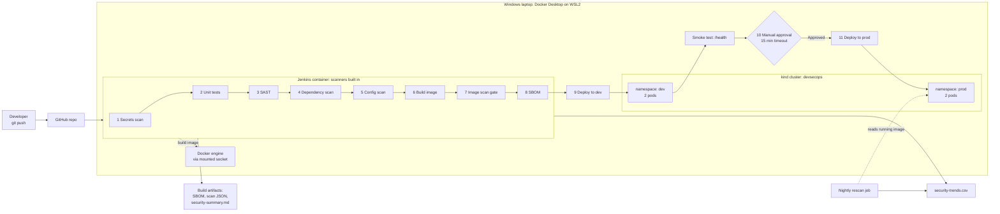

# Jenkins DevSecOps Pipeline with Docker and Kubernetes

A Jenkins pipeline that tests a small Python app, runs five security checks, builds and scans a Docker image, produces a Software Bill of Materials (SBOM), and deploys to Kubernetes only if every required check passes. A nightly job rescans whatever is running in prod against that day's Common Vulnerabilities and Exposures (CVE) data.

**Status:** In progress. The design, build steps, and pipeline code are written. Screenshots and results get added as I build each stage. Nothing in the Results section is claimed until I've run it.

---

## 🎬 Video Walkthrough

**[Watch the walkthrough](LOOM_LINK_HERE)**

*Placeholder: replace `LOOM_LINK_HERE` with the Loom share link after the Core build is finished.*

The video will cover:

- the architecture and the pipeline stages
- a green run that stops at the production approval gate
- a build that fails on a deliberately vulnerable dependency
- the fix, and the same pipeline passing
- the app running in Kubernetes

---

## Project Overview

### What this project does, in plain English

Think of an inspection line in a factory. A product moves through several stations before it can ship. One station checks that it works. Another checks that nobody left something dangerous inside. Another checks the purchased parts against a recall list. Another checks that it was assembled safely. If an important check fails, the line stops.

Jenkins is the line. The product is a small web app. Each stage asks one question, and if the answer is bad, nothing gets deployed.

Where the analogy breaks down: a factory inspects a product once, before it ships. Here, a nightly job inspects the product again after it has shipped, because the recall list can change after delivery.

### Why it matters

Security review often happens once, near the end, by hand. By then a vulnerable library is already inside the image, and fixing it means rework and a slipped schedule.

The opposite failure is also common. A team runs every scanner, gets hundreds of findings, and lets the pipeline pass anyway because nobody decided which findings should block a release.

This project takes the middle path:

- Each stage answers one question.
- Only findings that matter stop the build.
- Every accepted risk goes in a file with a reason, an approver, and an expiry date.

### What gets built

| Piece | Details |
|-------|---------|
| **Application** | A small Flask service with `/`, `/health`, and `/version`. It's simple on purpose; the pipeline is the project. |
| **Tests** | pytest unit tests, published to Jenkins as JUnit results. |
| **Docker image** | Multi-stage build on `python:3.12-slim-bookworm`, running as non-root user ID (UID) 10001. |
| **Jenkins** | A custom Jenkins image with Trivy, Semgrep, pip-audit, kubectl, kind, and the Docker command-line interface (CLI) installed at pinned versions. The pipeline is a `Jenkinsfile` in the repo. |
| **Kubernetes** | A local kind cluster named `devsecops` with `dev` and `prod` namespaces. Each runs a Deployment (2 replicas) and a ClusterIP Service. |
| **Pod hardening** | Non-root, read-only root filesystem, all Linux capabilities dropped, no privilege escalation, seccomp `RuntimeDefault`, no service account token, resource limits, readiness and liveness probes. |
| **Accepted-risk register** | `.trivyignore`. Starts empty. Every entry needs a reason, an approver, and an expiry date. |
| **Reports** | Scanner reports in JavaScript Object Notation (JSON), a CycloneDX SBOM, JUnit results, and `security-summary.md`, archived with every build. |
| **Nightly rescan** | A second Jenkins job that reads the image running in `prod` and rescans it. |

### Skills demonstrated

- Jenkins declarative pipelines (pipeline-as-code), credentials, manual approval gates, scheduled jobs
- Continuous Integration and Continuous Delivery (CI/CD) stage design with fail-fast ordering
- DevSecOps: secrets scanning, Static Application Security Testing (SAST), Software Composition Analysis (SCA), Dockerfile and manifest scanning, image scanning
- SBOM generation in CycloneDX format
- Docker multi-stage builds and non-root containers
- Kubernetes Deployments, Services, namespaces, probes, and security contexts
- Security gates with documented, expiring exceptions
- Security posture reporting from scanner output (summary file and a trend file in comma-separated values (CSV) format)
- Troubleshooting networking between Jenkins, Docker, and kind
- Working on Windows through the Windows Subsystem for Linux (WSL), version 2 (WSL2)
- Writing down technical decisions and their limits

---

## Project Structure

```text
jenkins-devsecops-pipeline/
├── README.md
├── DRAWIO-PLAN.md             # how to redraw the architecture diagram
├── architecture.drawio        # editable diagram (open in draw.io)
├── Jenkinsfile                # main pipeline
├── NOTES.md                   # build log: errors hit and how I fixed them
├── .gitignore
├── .trivyignore               # accepted-risk register
├── images/
│   ├── architecture.png       # exported from draw.io
│   └── ...                    # screenshots, named by step
├── app/
│   ├── app.py
│   ├── requirements.txt       # pinned; pip-audit checks this
│   ├── Dockerfile
│   ├── .dockerignore
│   └── tests/test_app.py
├── k8s/
│   ├── namespaces.yaml
│   ├── deployment.yaml
│   └── service.yaml
├── jenkins/
│   ├── Dockerfile             # Jenkins plus the scanners
│   └── Jenkinsfile.rescan     # nightly rescan of prod
└── scripts/
    └── security_summary.py    # scanner JSON to summary and trend row
```

---

## Architecture Diagram


*Export from draw.io using `DRAWIO-PLAN.md`. Until then, the Mermaid version below shows the same flow.*



---

## How It Works

1. **Push.** Code, Dockerfile, Kubernetes manifests, and the `Jenkinsfile` live in GitHub. Jenkins builds what's in GitHub, not what's on your machine.
2. **Secrets scan.** Trivy looks for committed credentials. Any hit fails the build.
3. **Unit tests.** pytest checks that the app still works.
4. **SAST.** Semgrep reads the Python source with the `p/python` rules and fails on any ERROR-level finding.
5. **Dependency scan (SCA).** pip-audit checks `requirements.txt` and everything it pulls in against known vulnerabilities. This runs before an image exists.
6. **Config scan.** Trivy checks the Dockerfile and the Kubernetes manifests, and fails on HIGH or CRITICAL misconfigurations.
7. **Build image.** `docker build --pull`, so each build picks up the newest patch of the base image.
8. **Image scan gate.** Trivy scans the finished image and fails on HIGH or CRITICAL CVEs that have a fix available.
9. **SBOM.** Trivy writes a CycloneDX inventory of everything inside the image. This stage never fails the build.
10. **Deploy to dev.** The image is loaded into kind and applied to the `dev` namespace. Jenkins waits for the rollout to finish.
11. **Smoke test.** A short-lived pod calls `/health`. A running container isn't enough; the app has to answer.
12. **Approval.** A person approves the move to `prod`, or the build times out after 15 minutes. This is continuous delivery, not continuous deployment.
13. **Deploy to prod.** The same build number goes to the `prod` namespace.
14. **After every build.** `security_summary.py` writes a one-page summary and adds a row to a trend file, even when the build failed.

### Pipeline stages at a glance

| # | Stage | Question it answers | Tool | Fails the build when |
|---|-------|---------------------|------|----------------------|
| 1 | Secrets scan | Did anyone commit a credential? | Trivy | Any secret is found |
| 2 | Unit tests | Does the code still work? | pytest | Any test fails |
| 3 | SAST | Does our code contain a dangerous pattern? | Semgrep | Any ERROR-level finding |
| 4 | Dependency scan (SCA) | Do our libraries have known CVEs? | pip-audit | Any known vulnerability |
| 5 | Config scan | Are the Dockerfile and manifests insecure? | Trivy | HIGH or CRITICAL misconfiguration |
| 6 | Build image | n/a | Docker | Build error |
| 7 | Image scan gate | Does the image carry a serious CVE with a fix? | Trivy | HIGH or CRITICAL with a fix available |
| 8 | SBOM | What is inside this image? | Trivy (CycloneDX) | Never |
| 9 | Deploy to dev + smoke test | Does it start and answer `/health`? | kubectl | Rollout or `/health` fails |
| 10 | Approve prod | Does a person approve? | Jenkins `input` | Rejected or 15-minute timeout |
| 11 | Deploy to prod | n/a | kubectl | Rollout fails |
| Nightly | Rescan prod | Is what's running still clean today? | Trivy | New HIGH/CRITICAL with a fix |

---

## Key Terms

| Term | What it means |
|------|---------------|
| **Jenkins** | An open source automation server. The pipeline is described in a `Jenkinsfile` kept in the repo. |
| **Declarative pipeline** | The structured Jenkinsfile syntax: `pipeline { stages { stage { steps } } }`. |
| **DevSecOps / shift left** | Putting security checks in each pipeline stage so problems are caught when they're cheap to fix. |
| **Security gate** | A stage set to fail the build when a rule is broken. A scanner without a gate is just a report. |
| **Static Application Security Testing (SAST)** | Reads source code without running it. |
| **Software Composition Analysis (SCA)** | Checks third-party libraries against known vulnerabilities. |
| **Common Vulnerabilities and Exposures (CVE)** | A public identifier (ID) for a known vulnerability, like CVE-2024-6345. |
| **Software Bill of Materials (SBOM)** | An inventory of every package and version inside the image. When a new CVE is announced, it tells you quickly whether you're affected. |
| **Smoke test** | A quick check after deployment that the app starts and answers. It's a floor, not full test coverage. |
| **Accepted risk** | A finding reviewed and deliberately not fixed yet, recorded with a reason, approver, and expiry date. |
| **kind** | "Kubernetes in Docker." A real Kubernetes cluster running as Docker containers on one machine. |
| **Namespace** | A way to separate workloads inside one Kubernetes cluster. Here: `dev` and `prod`. |
| **Windows Subsystem for Linux 2 (WSL2)** | A real Linux environment inside Windows. |

---

## Prerequisites

Everything runs on one machine, and no cloud account is needed. Total cost: $0.

**Windows users:** this guide uses the Windows Subsystem for Linux (WSL). You run every command in an Ubuntu terminal and keep the project in your Linux home folder. Step 1 walks through the setup.

**What you need**

| Requirement | What it's for |
|-------------|---------------|
| Windows 10 (version 2004 or later) or Windows 11, with virtualization enabled | Needed to run WSL2 and Docker Desktop |
| Windows Subsystem for Linux 2 (WSL2) with Ubuntu 24.04 | A real Linux shell for every command in this guide |
| Docker Desktop with WSL integration turned on | Builds images and runs Jenkins and the cluster |
| kind and kubectl | A local Kubernetes cluster and the command line for it |
| Git and a GitHub account | Jenkins builds from your repository |
| Python 3 with `venv` | Runs the tests locally before you push |
| A code editor, such as VS Code with its WSL extension | Editing files that live in Ubuntu |
| At least 8 GB of memory (16 GB is more comfortable) | Jenkins, Docker, and the cluster run at the same time |
| About 10 GB of free disk space | Docker images and the scanners' vulnerability databases |
| An internet connection | Pulling images and downloading scanner databases |

Linux and macOS users can follow the same steps. Skip the Windows-only parts of Step 1 and install the tools with your system's package manager.

**Time:** about 7–9 hours to build, plus setup time. The first Jenkins build takes 5–10 minutes while the scanners download their databases.

**One rule on Windows:** work only in the Ubuntu (WSL2) terminal and keep the project in `~/projects`, never under `/mnt/c/`. That avoids most problems with line endings, slow builds, and permissions.

---

## Naming Conventions Used

| Resource | Value |
|----------|-------|
| GitHub repo | `jenkins-devsecops-pipeline` (public) |
| kind cluster | `devsecops` |
| Kubernetes namespaces | `dev`, `prod` |
| Deployment and Service | `devsecops-app` |
| App image | `devsecops-app:<Jenkins build number>` |
| Jenkins image | `jenkins-devsecops:1.0` |
| Jenkins container and volume | `jenkins`, `jenkins_home` |
| Jenkins credential ID | `kind-kubeconfig` |
| Jenkins jobs | `devsecops-pipeline`, `prod-nightly-rescan` |
| Ports | Jenkins `8080`, app container `8080`, Service `80` |
| Linux user in the image | UID `10001` |

---

## Project Steps

Screenshot notes are marked with 📸. Save them in `images/` using the suggested file names. All commands run in the Ubuntu terminal from `~/projects/jenkins-devsecops-pipeline` unless a step says PowerShell or a browser.

### Step 1: Prepare your environment

Install the tools from the [Prerequisites](#prerequisites) table. Docker needs to be running before you go on. Pin the versions of kind and kubectl to a current stable release, because a build that silently pulls "latest" isn't reproducible. The versions shown were current when this guide was written.

**On Windows, do this first:**

1. **Check the machine.** Windows 11, or Windows 10 version 2004 or later. In Task Manager → Performance → CPU, virtualization should show **Enabled**.
2. **Install WSL2 and Ubuntu.** In PowerShell as Administrator:

   ```powershell
   wsl --install -d Ubuntu-24.04
   wsl -l -v
   ```

   Restart when prompted. The VERSION column should show `2`.
3. **Cap WSL's memory** so Windows stays responsive. Create `C:\Users\<your-windows-username>\.wslconfig`:

   ```ini
   [wsl2]
   memory=8GB
   processors=4
   ```

   Use `5GB` on an 8 GB machine, then run `wsl --shutdown` in PowerShell.
4. **Install Docker Desktop.** Turn on **Use the WSL 2 based engine** and **WSL integration → Ubuntu-24.04**. Leave Docker Desktop's own Kubernetes **off**, since this project uses kind.
5. **Install VS Code and its WSL extension.** Open projects from Ubuntu with `code .`.
6. **Do the rest of Step 1 and everything after it inside the Ubuntu terminal.**

**Tell Git who you are, once:**

```bash
git config --global user.name "<your-name>"
git config --global user.email "<the email on your GitHub account>"
git config --global init.defaultBranch main
git config --global core.autocrlf input
```

`core.autocrlf input` keeps line endings in the Linux style, Line Feed (LF), even if you're on Windows.

**On Ubuntu or WSL, install the base packages:**

```bash
sudo apt update && sudo apt upgrade -y
sudo apt install -y git curl python3 python3-venv python3-pip
```

**Install kind and kubectl** on Linux or WSL (on macOS, use Homebrew: `brew install kind kubectl`):

```bash
ARCH=$(dpkg --print-architecture)
curl -Lo kind https://kind.sigs.k8s.io/dl/v0.24.0/kind-linux-${ARCH}
curl -LO https://dl.k8s.io/release/v1.31.1/bin/linux/${ARCH}/kubectl
chmod +x kind kubectl && sudo mv kind kubectl /usr/local/bin/
```

### Step 2: Check the environment

Run this before writing any project code:

```bash
docker run --rm hello-world
kind create cluster --name smoke-test
kubectl get nodes        # one node, STATUS Ready
kind delete cluster --name smoke-test
python3 --version
git --version
```

📸 **Screenshot `01-environment-check.png`:** the terminal showing `kubectl get nodes` with a node in `Ready` state.


### Step 3: Create the repo and folders

Create a public GitHub repo named `jenkins-devsecops-pipeline` with a README. It's public so Jenkins can clone it without credentials. Then:

```bash
mkdir -p ~/projects && cd ~/projects
git clone https://github.com/<your-github-username>/jenkins-devsecops-pipeline.git
cd jenkins-devsecops-pipeline
mkdir -p app/tests k8s jenkins scripts images
code .
```

Start `NOTES.md` now. Every time something breaks, write three lines: what you saw, what caused it, and how you fixed it.

📸 **Screenshot `02-folder-structure.png`:** the repo folders in VS Code.


### Step 4: Build the application

Three files in `app/`.

**`app/app.py`**: three endpoints. `APP_VERSION` is set to the Jenkins build number at deploy time, so you can prove which build is running.

```python
import os
from flask import Flask, jsonify

app = Flask(__name__)
APP_VERSION = os.environ.get("APP_VERSION", "dev")

@app.get("/")
def index():
    return jsonify(message="DevSecOps demo service", version=APP_VERSION)

@app.get("/health")
def health():
    return jsonify(status="ok"), 200

@app.get("/version")
def version():
    return jsonify(version=APP_VERSION)

if __name__ == "__main__":
    # Local debugging only. In the container, gunicorn serves the app.
    app.run(host="127.0.0.1", port=8080)
```

**`app/requirements.txt`**: pinned, so pip-audit checks exact versions.

```text
flask==3.0.3
gunicorn==23.0.0
```

**`app/tests/test_app.py`**: two tests, one for `/health` and one for the version field in `/`.

Run the tests locally:

```bash
python3 -m venv .venv && . .venv/bin/activate
pip install -r app/requirements.txt pytest
pytest app/tests        # expect: 2 passed
deactivate
```

📸 **Screenshot `03-tests-passed.png`:** pytest showing `2 passed`.


### Step 5: Build the Docker image

**`app/Dockerfile`**: two stages. Build tools stay in the first stage and never reach the image that ships.

```dockerfile
# ---- build stage: install dependencies into an isolated folder ----
FROM python:3.12-slim-bookworm AS build
WORKDIR /build
COPY requirements.txt .
RUN pip install --no-cache-dir --prefix=/install -r requirements.txt

# ---- runtime stage: only what the app needs to run ----
FROM python:3.12-slim-bookworm
ENV PYTHONDONTWRITEBYTECODE=1 \
    PYTHONUNBUFFERED=1
RUN useradd --uid 10001 --no-create-home --shell /usr/sbin/nologin appuser
WORKDIR /app
COPY --from=build /install /usr/local
COPY app.py .
USER 10001
EXPOSE 8080
CMD ["gunicorn", "--bind", "0.0.0.0:8080", "--workers", "2", "--worker-tmp-dir", "/tmp", "app:app"]
```

**`app/.dockerignore`**:

```text
tests/
__pycache__/
*.pyc
```

Optional local check that the image runs:

```bash
docker build -t devsecops-app:test app/
docker run --rm -p 8081:8080 devsecops-app:test
# in a second terminal:
curl http://localhost:8081/health      # {"status":"ok"}
```

Why these choices:

- **Multi-stage:** fewer packages in the final image means fewer CVEs.
- **Slim base:** far fewer operating system (OS) packages than the full Python image. On a real Department of Defense (DoD) program I'd start from an approved hardened image instead.
- **Non-root user:** if the app is compromised, the attacker is UID 10001 with no shell, not root.

📸 **Screenshot `04-local-container-health.png`:** `curl` returning `{"status":"ok"}` from the container.


### Step 6: Write the Kubernetes manifests

Three files in `k8s/`.

**`k8s/namespaces.yaml`**: creates `dev` and `prod`.

```yaml
apiVersion: v1
kind: Namespace
metadata:
  name: dev
---
apiVersion: v1
kind: Namespace
metadata:
  name: prod
```

**`k8s/service.yaml`**: a ClusterIP Service on port 80 pointing at container port 8080.

```yaml
apiVersion: v1
kind: Service
metadata:
  name: devsecops-app
spec:
  type: ClusterIP
  selector:
    app: devsecops-app
  ports:
    - port: 80
      targetPort: 8080
```

**`k8s/deployment.yaml`**: two replicas with a hardened pod spec. `BUILD_TAG` is a placeholder that the pipeline replaces with the Jenkins build number at deploy time, so every deployment points at an exact, scanned image and never `latest`.

<details>
<summary>Show deployment.yaml</summary>

```yaml
apiVersion: apps/v1
kind: Deployment
metadata:
  name: devsecops-app
  labels:
    app: devsecops-app
spec:
  replicas: 2
  selector:
    matchLabels:
      app: devsecops-app
  template:
    metadata:
      labels:
        app: devsecops-app
    spec:
      automountServiceAccountToken: false
      securityContext:
        runAsNonRoot: true
        runAsUser: 10001
        runAsGroup: 10001
        seccompProfile:
          type: RuntimeDefault
      containers:
        - name: app
          image: devsecops-app:BUILD_TAG
          imagePullPolicy: IfNotPresent
          ports:
            - containerPort: 8080
          env:
            - name: APP_VERSION
              value: "BUILD_TAG"
          securityContext:
            allowPrivilegeEscalation: false
            readOnlyRootFilesystem: true
            capabilities:
              drop: ["ALL"]
          resources:
            requests:
              cpu: 50m
              memory: 64Mi
            limits:
              cpu: 250m
              memory: 128Mi
          readinessProbe:
            httpGet:
              path: /health
              port: 8080
            initialDelaySeconds: 3
            periodSeconds: 5
          livenessProbe:
            httpGet:
              path: /health
              port: 8080
            initialDelaySeconds: 10
            periodSeconds: 10
          volumeMounts:
            - name: tmp
              mountPath: /tmp
      volumes:
        - name: tmp
          emptyDir: {}
```

</details>

| Setting | Why |
|---------|-----|
| `runAsNonRoot`, `runAsUser: 10001` | Kubernetes refuses to start the pod if the image tries to run as root |
| `readOnlyRootFilesystem: true` | An attacker can't write tools or change files. `/tmp` is a separate scratch volume because gunicorn needs it. |
| `allowPrivilegeEscalation: false`, drop `ALL` capabilities | The process can't gain more privileges than it started with |
| `seccompProfile: RuntimeDefault` | Blocks dangerous system calls |
| `automountServiceAccountToken: false` | The app doesn't call the Kubernetes application programming interface (API), so it gets no token to steal |
| Resource requests and limits | One misbehaving pod can't starve the node |
| Readiness and liveness probes | Traffic only goes to pods that answer `/health`; stuck pods restart |

### Step 7: Add the accepted-risk register and the summary script

- **`.trivyignore`** starts empty on purpose. It documents the rules: every entry needs a CVE ID with an expiry date (`exp:YYYY-MM-DD`), a reason, an approver, and a ticket. After the expiry date Trivy reports the CVE again and the gate fails again. Check that your Trivy version supports the `exp:` syntax; if it doesn't, keep the date in a comment and review the file on a schedule.
- **`scripts/security_summary.py`** reads the scanner JSON from each build and writes `security-summary.md` plus one row in a trend CSV. That row is how you answer "is our posture getting better or worse?" with numbers.

Commit and push:

```bash
git add . && git commit -m "App, Dockerfile, manifests, summary script" && git push
```

### Step 8: Create the Kubernetes cluster

```bash
kind create cluster --name devsecops
kubectl get nodes                  # devsecops-control-plane   Ready
kubectl apply -f k8s/namespaces.yaml
kubectl get ns dev prod
```

Creating the cluster also creates a Docker network called `kind`. Jenkins joins it in the next step.

📸 **Screenshot `05-kind-cluster.png`:** `kubectl get nodes` and `kubectl get ns dev prod`.


### Step 9: Build and run Jenkins

**`jenkins/Dockerfile`** builds a Jenkins server with every scanner installed at a pinned version, so each build uses exactly the same tools.

<details>
<summary>Show jenkins/Dockerfile</summary>

```dockerfile
FROM jenkins/jenkins:2.462.3-lts-jdk17
USER root

ARG TRIVY_VERSION=0.56.2
ARG KIND_VERSION=v0.24.0
ARG KUBECTL_VERSION=v1.31.1

# Docker CLI (talks to Docker Desktop through the mounted socket), Python, curl
RUN apt-get update \
 && apt-get install -y --no-install-recommends docker.io python3 python3-venv curl ca-certificates \
 && rm -rf /var/lib/apt/lists/*

# Trivy, kind, kubectl: pinned versions, correct CPU architecture
RUN ARCH=$(dpkg --print-architecture) \
 && curl -sSfL https://raw.githubusercontent.com/aquasecurity/trivy/main/contrib/install.sh \
    | sh -s -- -b /usr/local/bin v${TRIVY_VERSION} \
 && curl -sSfLo /usr/local/bin/kind https://kind.sigs.k8s.io/dl/${KIND_VERSION}/kind-linux-${ARCH} \
 && curl -sSfLo /usr/local/bin/kubectl https://dl.k8s.io/release/${KUBECTL_VERSION}/bin/linux/${ARCH}/kubectl \
 && chmod +x /usr/local/bin/kind /usr/local/bin/kubectl

# Python scanners in their own virtual environment
RUN python3 -m venv /opt/scanners \
 && /opt/scanners/bin/pip install --no-cache-dir semgrep==1.90.0 pip-audit==2.7.3
ENV PATH="/opt/scanners/bin:${PATH}"

USER jenkins
```

</details>

Build and run it:

```bash
docker build -t jenkins-devsecops:1.0 jenkins/
docker volume create jenkins_home

docker run -d --name jenkins --restart unless-stopped \
  -u root \
  -p 8080:8080 \
  -v jenkins_home:/var/jenkins_home \
  -v /var/run/docker.sock:/var/run/docker.sock \
  --network kind \
  jenkins-devsecops:1.0
```

Confirm the tools are installed and Jenkins can reach Docker:

```bash
docker exec jenkins trivy --version
docker exec jenkins semgrep --version
docker exec jenkins pip-audit --version
docker exec jenkins kubectl version --client
docker exec jenkins docker ps
docker exec jenkins cat /var/jenkins_home/secrets/initialAdminPassword
```

Open `http://localhost:8080` in the Windows browser, paste the password, choose **Install suggested plugins**, and create an admin user. If a build later says `No such DSL method 'timestamps'` or `'junit'`, install the **Timestamper** and **JUnit** plugins.

> **Lab shortcuts here.** Mounting the Docker socket, running the container as root, and building on the Jenkins controller are fine on a laptop and wrong in production. See [Lab Shortcuts](#lab-shortcuts).

📸 **Screenshot `06-jenkins-tools.png`:** the version output of `trivy`, `semgrep`, `pip-audit`, and `kubectl` from inside the Jenkins container.


### Step 10: Give Jenkins access to the cluster as a credential

The normal kind kubeconfig points at `127.0.0.1`, which inside the Jenkins container means Jenkins itself. The `--internal` flag gives an address on the kind Docker network instead.

```bash
kind get kubeconfig --name devsecops --internal > kind-internal.kubeconfig

# prove Jenkins can reach the cluster with it
docker cp kind-internal.kubeconfig jenkins:/tmp/k
docker exec jenkins kubectl --kubeconfig /tmp/k get nodes
docker exec jenkins rm /tmp/k
```

In Jenkins: **Manage Jenkins → Credentials → System → Global credentials → Add Credentials**

- Kind: **Secret file**
- File: `kind-internal.kubeconfig`
- ID: `kind-kubeconfig`

Then delete the local copy:

```bash
rm kind-internal.kubeconfig
```

The kubeconfig never goes in the repo. `.gitignore` blocks `*.kubeconfig`, and the secrets scan is a second layer if that ever fails.

📸 **Screenshot `07-jenkins-credential.png`:** the credential listed in Jenkins by ID. Don't show file contents.


### Step 11: Write the Jenkinsfile

The `Jenkinsfile` at the repo root defines the 13 stages in [Pipeline stages at a glance](#pipeline-stages-at-a-glance). Every security stage follows one pattern: **collect evidence, then gate.** The first command writes a JSON report and never fails (`|| true`). The second enforces the rule and fails the build. A blocked build still leaves a report that explains why.

Three details worth knowing:

- **Cheapest checks first.** Secrets and tests take seconds. Building and scanning an image takes minutes.
- **`--ignore-unfixed` on the image gate.** The gate fails only on HIGH or CRITICAL CVEs that have a fix. Unfixed CVEs stay in the report and trend data but don't block a build nobody can fix.
- **`docker build --pull`.** Each build pulls the newest patch of the base image.

A `post { always { ... } }` block runs `scripts/security_summary.py`, publishes JUnit results, and archives `reports/**`, even when a stage failed.

```bash
git add Jenkinsfile && git commit -m "Add Jenkins DevSecOps pipeline" && git push
```

### Step 12: Create the pipeline job and run it

In Jenkins: **New Item → `devsecops-pipeline` → Pipeline → OK**

- Definition: **Pipeline script from SCM** (Source Control Management, here Git)
- SCM: **Git**, repository `https://github.com/<your-github-username>/jenkins-devsecops-pipeline.git`
- Branch: `*/main`
- Script Path: `Jenkinsfile`

Save, then **Build Now**. The first build takes 5–10 minutes because Trivy and Semgrep download their databases. When it reaches **Approve prod**, hover over the stage and click **Approve**.

📸 **Screenshot `08-green-pipeline.png`:** the Stage View with all stages green through **Smoke test (dev)**, paused at **Approve prod**.


📸 **Screenshot `09-pipeline-complete.png`:** the Stage View after approval, with **Deploy to prod** green.


### Step 13: Verify the deployment

```bash
kubectl -n dev get pods,svc
kubectl -n prod get pods,svc

# prove which build is running in prod
kubectl -n prod port-forward svc/devsecops-app 9090:80 &
curl -s localhost:9090/version        # expect {"version":"1"}, the build number
kill %1

# confirm the hardening actually applied
kubectl -n prod exec deploy/devsecops-app -- id                 # expect uid=10001
kubectl -n prod exec deploy/devsecops-app -- touch /app/test    # expect: Read-only file system
```

Download the build's artifacts: `security-summary.md`, `sbom.cdx.json`, `trivy-image.json`, `pip-audit.json`, `semgrep.json`, and the test results. Open the SBOM and confirm it lists both the Python packages from `requirements.txt` and the OS packages from the base image.

**The Core is done when all of this works.**

📸 **Screenshot `10-prod-verify.png`:** `kubectl -n prod get pods,svc`, the `/version` response, and the `id` and `touch` results.


📸 **Screenshot `11-build-artifacts.png`:** the build's artifacts page listing the SBOM, scan JSON files, and `security-summary.md`.


### Step 14: Break it on purpose

A gate you've never seen fail is a gate you can't explain. For each test: screenshot the red build, fix it, screenshot the green one.

| Test | Change | Expected failing stage |
|------|--------|------------------------|
| E1: vulnerable library | Add `requests==2.19.1` to `app/requirements.txt` | Dependency scan (SCA) |
| E2: outdated base image | Change both `FROM` lines to `python:3.12.0-slim-bookworm` | Image scan gate |
| E3: accepted risk | Add one CVE from E2 to `.trivyignore` with an expiry date | That CVE stops counting; the rest still fail |
| E4: leaked secret | Create a fake token file and scan it locally. **Do not push it.** | Secrets scan |
| E5: insecure manifest | Add `privileged: true` to the container's `securityContext` | Config scan |

**E1: vulnerable library (SCA gate).** Push the change. The Dependency scan stage fails and lists CVE IDs with the fixed version. Nothing after it runs, so nothing deploys. Remove the line, push, and the build goes green.

📸 **Screenshot `12-sca-failed.png`:** Stage View red at **Dependency scan (SCA)**, with the CVE IDs in the console log.


📸 **Screenshot `13-sca-fixed.png`:** the same pipeline green after the fix.


**E2: outdated base image (image scan gate).** Push the change. Everything passes until **Image scan gate**, which fails on fixable HIGH or CRITICAL OS-package CVEs. Write the count in `NOTES.md`, and use only the number I actually see. If the old tag happens to scan clean, try an older one. Revert to `python:3.12-slim-bookworm`, push, and the build goes green. This before-and-after is the core demo.

📸 **Screenshot `14-image-scan-failed.png`:** red at **Image scan gate** with the Trivy finding count.


📸 **Screenshot `15-image-scan-passed.png`:** green after reverting to the current base image.


**E3: accepted risk with an expiry.** While E2 is failing, pick one CVE from the report and add it to `.trivyignore`:

```text
CVE-XXXX-XXXXX exp:2026-11-30
# reason: lab exercise, demonstrating the exception process
# approved-by: <your-name> (lab owner) ticket: LAB-001
```

Rerun. That CVE no longer counts against the gate, while the others still fail it. Then remove the entry. An exception is visible, owned, and temporary. It is never a silent `--exit-code 0`.

📸 **Screenshot `16-accepted-risk.png`:** the `.trivyignore` entry and the rerun result.


**E4: leaked secret (local only).**

```bash
printf 'GITHUB_TOKEN=ghp_%s\n' $(head -c 200 /dev/urandom | LC_ALL=C tr -dc 'A-Za-z0-9' | head -c 36) > leak-test.env
docker run --rm -v "$PWD:/src" aquasec/trivy:0.56.2 fs --scanners secret --exit-code 1 /src
rm leak-test.env
```

Trivy should flag the token and exit non-zero. Don't push this file. GitHub push protection may block it before Jenkins ever sees it, which is a second layer worth mentioning.

📸 **Screenshot `17-secret-detected.png`:** Trivy flagging the fake token.


**E5: insecure manifest (config gate).** Push the change. Config scan fails on a HIGH misconfiguration before any image is built. Revert.

📸 **Screenshot `18-config-scan-failed.png`:** red at **Config scan**.


### Step 15: Add the nightly rescan

A clean scan is only true on the day it ran. New CVEs are published daily against packages that are already deployed. `jenkins/Jenkinsfile.rescan` finds the image running in `prod`, rescans it with the same rules as the main gate, and adds a row to the trend file. A failure means a new fixable HIGH or CRITICAL CVE has appeared, and the fix is to rebuild, since the main pipeline pulls the patched base image.

In Jenkins: **New Item → `prod-nightly-rescan` → Pipeline**, with the same Git settings as Step 12 but **Script Path** `jenkins/Jenkinsfile.rescan`. Click **Build Now** once so Jenkins registers the daily cron trigger.

After a few builds, look at the trend file:

```bash
docker exec jenkins cat /var/jenkins_home/security-trends.csv
docker cp jenkins:/var/jenkins_home/security-trends.csv .
```

Each row is one build or nightly scan with finding counts by severity. Chart it in Excel or Google Sheets for the README.

> **Lab limit.** The nightly job only runs while your laptop is awake, Docker Desktop is running, and the Jenkins container is up. For a demo, trigger it with Build Now. On a real program it would run on an always-on server and notify a team on failure. Notifications aren't built here.

📸 **Screenshot `19-nightly-rescan.png`:** the `prod-nightly-rescan` job page with at least one completed run.


📸 **Screenshot `20-security-summary.png`:** a sample `security-summary.md`, plus the trend CSV chart if you make one.


### Step 16: Finish and clean up

- Replace `LOOM_LINK_HERE` with the Loom link, add the screenshots, and fill in the Results table.
- Keep everything running until after the interview. A live build on screen share is worth it.
- Cleanup, **only after the interview**:

  ```bash
  docker rm -f jenkins
  docker volume rm jenkins_home
  kind delete cluster --name devsecops
  ```

---

## Results

*To be filled in after the build. I only enter numbers I actually saw.*

| Check | Result |
|-------|--------|
| Environment check passed | ☐ |
| Unit tests passed locally | ☐ |
| Jenkins tools verified | ☐ |
| First green run through Smoke test | ☐ |
| `/version` in prod returns the build number | ☐ |
| Pod runs as UID 10001 | ☐ |
| Writing to the container filesystem is blocked | ☐ |
| SBOM lists Python and OS packages | ☐ |
| E1 failed at Dependency scan, then passed after the fix | ☐ |
| E2 fixable HIGH/CRITICAL count, old base image | `[N]` |
| E2 fixable HIGH/CRITICAL count, current base image | `[N]` |
| E3 exception honored, then removed | ☐ |
| E4 secret detected locally | ☐ |
| E5 failed at Config scan | ☐ |
| Nightly rescan ran | ☐ |
| Time for first build (databases downloading) | `[minutes]` |
| Time for a cached build | `[minutes]` |
| Jenkins build number of the green run | `[#]` |

What I'll note here: anything that broke, what fixed it, and how long each phase took compared to the estimates.

---

## Security Decisions

- **Checks run before deployment.** Problems are cheaper to fix before they reach an environment.
- **Cheap checks first.** Secrets and tests take seconds, so a bad commit fails before the image is built.
- **Evidence, then gate.** Each scanner writes a report first, so a blocked build still explains why.
- **Fail only on fixable HIGH and CRITICAL image findings.** Unfixed CVEs stay in the report and trend data but don't block a build nobody can fix. This keeps the gate strict without making it noise.
- **Exceptions are written down.** Reason, approver, ticket, and expiry date, in `.trivyignore`. After the expiry the gate fails again.
- **Cluster access is a Jenkins credential.** The kubeconfig is never in the repo.
- **The container runs as non-root.** A compromised process is UID 10001 with no shell.
- **The workload is hardened.** Read-only root filesystem, all capabilities dropped, no privilege escalation, seccomp, no service account token, resource limits, and probes.
- **Images are pinned by build number.** No `latest`. The deployed image is the exact one that was scanned.
- **A person approves prod.** This is continuous delivery, which fits change-controlled environments.
- **Prod is rescanned nightly.** A clean image today can be vulnerable tomorrow.

### Lab Shortcuts

This is a personal lab on one laptop. These shortcuts are fine here and wrong in production.

| Lab shortcut | Why it's risky | What production does |
|--------------|----------------|----------------------|
| Mounting `/var/run/docker.sock` into Jenkins | Anything that can use the socket effectively has root on the host | Dedicated build agents and daemonless image builds (Kaniko, Buildah) |
| Running the Jenkins container as root | Simplest way to get socket access, but far more privilege than needed | A non-root Jenkins user, or no socket at all |
| Building on the Jenkins controller | A malicious build could read Jenkins secrets | Builds run on separate agents; the controller only orchestrates |
| kind on a laptop | Not a managed platform | The Kubernetes platform the program has approved |

---

## Troubleshooting / Common Issues

Full list in the project guide. Add the errors you hit, and your fixes, to [`NOTES.md`](NOTES.md).

| Issue | Cause | Fix |
|-------|-------|-----|
| `docker: command not found` in Ubuntu | Docker Desktop's WSL integration is off | Docker Desktop → Settings → Resources → WSL integration → turn on Ubuntu-24.04 |
| `Cannot connect to the Docker daemon` | Docker Desktop isn't running | Start it and wait for "Engine running" |
| `$'\r': command not found` | File saved with Windows line endings, Carriage Return plus Line Feed (CRLF) | `dos2unix <file>`, switch VS Code to LF, keep the repo in `~/projects` |
| Everything is slow | Repo is under `/mnt/c/` | Move it to `~/projects` and re-clone |
| Jenkins restarts, or build dies with exit code 137 | Out of memory | Raise memory in `.wslconfig`, `wsl --shutdown`, close other apps |
| Deploy stage: connection refused to `127.0.0.1` | Jenkins is using the normal kubeconfig | Redo Step 10 with `--internal`; confirm Jenkins is on the `kind` network |
| `ErrImagePull` / `ImagePullBackOff` | Image wasn't loaded into kind, or the tag doesn't match | Check the log for `kind load docker-image`; `kubectl -n dev describe pod <name>` |
| `permission denied` on `docker.sock` inside Jenkins | Container isn't running as root | Re-run with `-u root` (Step 9) |
| `trivy` or `semgrep: not found` in Jenkins | Running the stock Jenkins image | Run the container from `jenkins-devsecops:1.0` |
| Port 8080 already in use | Another app is using it | Use `-p 8081:8080` and browse `localhost:8081` |
| Semgrep won't install | No wheel for your platform | Swap in Bandit (`bandit -r app -ll`) in `jenkins/Dockerfile` and the SAST stage |
| `No such DSL method 'timestamps'` or `'junit'` | A plugin is missing | Install Timestamper and JUnit in Manage Jenkins → Plugins |
| Pipeline doesn't see your latest change | Jenkins builds GitHub, not local files | Commit and push |
| Pod starts but health check fails | App isn't answering on `/health` | `kubectl logs <pod>` and check the Service |

Useful commands for Kubernetes debugging:

```bash
kubectl get pods -n dev
kubectl describe pod <pod-name> -n dev
kubectl logs <pod-name> -n dev
kubectl rollout status deployment/devsecops-app -n dev
kubectl get events -n dev
```

---

## Key Takeaways

These are the ideas this project is built to show. I'll revise them after the build based on what actually happened.

- **A scanner without a gate is only a report.** A finding matters when a policy says what happens next.
- **Each gate should answer one question.** Strict and actionable beats noisy and ignored.
- **Scan the finished artifact, not just the source.** The image contains OS packages that source scanning never sees.
- **A running container isn't a working app.** The smoke test checks that it answers.
- **Exceptions need an owner and an expiry date.** Otherwise they become permanent and invisible.
- **Security continues after release.** A clean scan is only true on the day it ran.

---

## Honest Scope

This is a lab project that runs on a single machine. It shows how a DevSecOps pipeline is designed, built, tested, and explained. It isn't a production deployment.

**Not covered:**

- Dynamic Application Security Testing (DAST), such as Open Worldwide Application Security Project (OWASP) Zed Attack Proxy (ZAP) against the running app
- Image signing (Cosign) and admission control that only runs signed images
- Air-gapped operation. On a closed network, Trivy and Semgrep can't download their databases, so they'd need internal mirrors and a private registry.
- Risk Management Framework (RMF) and Authorization to Operate (ATO) documentation, Security Technical Implementation Guide (STIG) checks, and Navy-specific guidance
- Notifications and ticketing when the nightly rescan fails

**What I'd do next:**

1. Add an OWASP ZAP baseline scan against the dev deployment.
2. Sign images with Cosign and verify signatures before deploy.
3. Move builds to a dedicated agent and replace the Docker socket with Kaniko.
4. Chart the trend data in Grafana.

---

## Reference

- [Jenkins Pipeline syntax](https://www.jenkins.io/doc/book/pipeline/syntax/)
- [Trivy documentation](https://trivy.dev/)
- [Semgrep documentation](https://semgrep.dev/docs/)
- [pip-audit](https://github.com/pypa/pip-audit)
- [kind](https://kind.sigs.k8s.io/)
- [Kubernetes documentation](https://kubernetes.io/docs/)
- [Docker documentation](https://docs.docker.com/)

---

**Author:** Manuel Yannick Armah
**Project:** Jenkins DevSecOps Pipeline with Docker and Kubernetes
**Difficulty:** Intermediate
**Time to Complete:** 7–9 hours, plus about 1 hour of Windows setup
